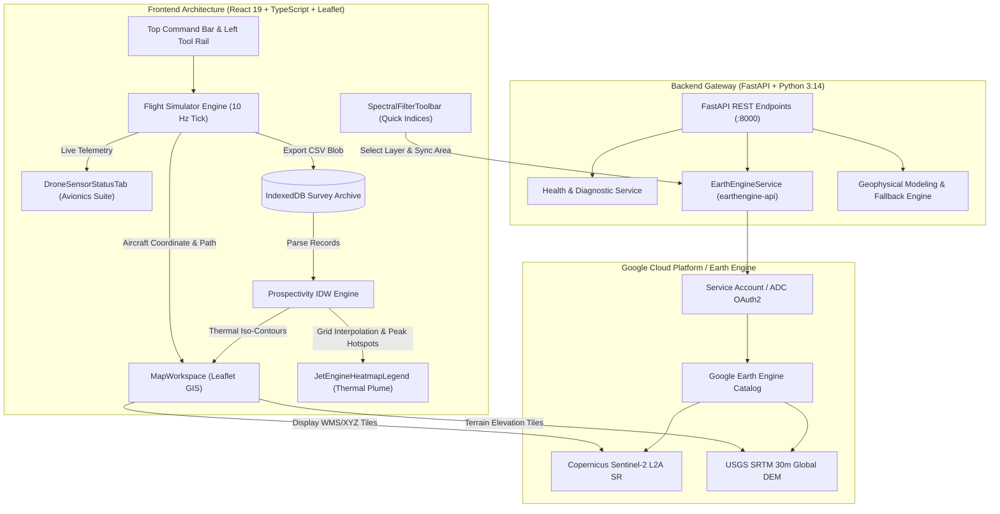
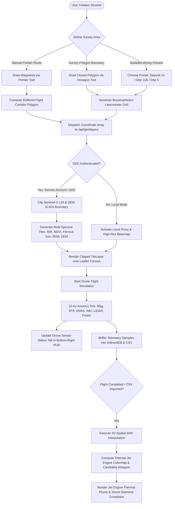
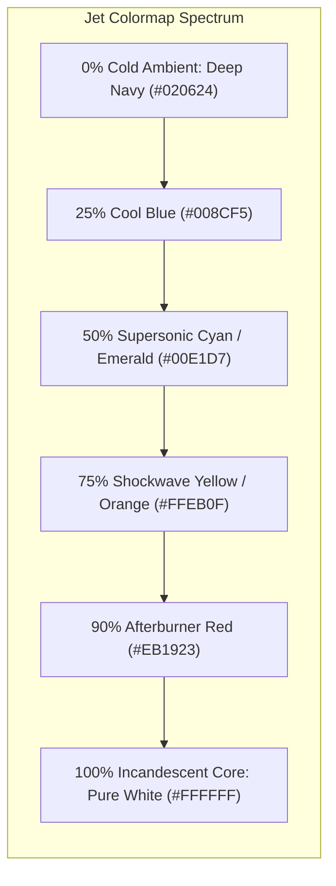
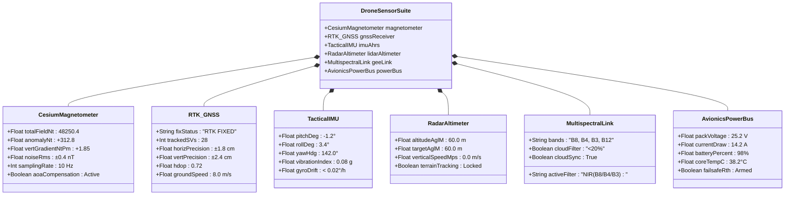
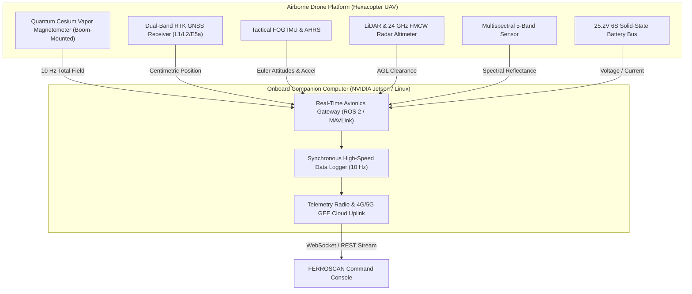

# FERROSCAN — Autonomous Airborne Magnetometry & Geospatial Prospectivity Intelligence Platform

[](https://github.com/Themahattava/FERROSCAN)
[](https://earthengine.google.com/)
[](https://github.com/Themahattava/FERROSCAN)
[](https://react.dev/)
[](https://fastapi.tiangolo.com/)

**FERROSCAN** is an enterprise-grade airborne mineral exploration and remote sensing command platform. Designed for precision geophysical surveys and multi-spectral iron-ore prospecting, FERROSCAN couples **autonomous UAV mission flight planning**, **synthetic scalar magnetometry simulation**, **Inverse Distance Weighting (IDW) spatial prospectivity analysis**, **hyperspectral vegetation & mineral indices from Google Earth Engine (GEE)**, and a **real-time 6-subsystem avionics sensor diagnostics suite**.

---

## 📑 Table of Contents

1. [System Architecture](#1-system-architecture)
2. [End-to-End Processing Flowchart](#2-end-to-end-processing-flowchart)
3. [Core Technical Capabilities](#3-core-technical-capabilities)
   - [Google Earth Engine Hyperspectral & Vegetation Filters](#31-google-earth-engine-hyperspectral--vegetation-filters)
   - [Dynamic Area Clipping for Custom Flight Paths](#32-dynamic-area-clipping-for-custom-flight-paths)
   - [Jet Engine Thermal Plume Prospectivity Heat Map](#33-jet-engine-thermal-plume-prospectivity-heat-map)
   - [Avionics & Drone Sensor Status Suite](#34-avionics--drone-sensor-status-suite)
   - [Geophysical Magnetometer Modeling](#35-geophysical-magnetometer-modeling)
4. [Hardware & Drone Avionics Sensor Architecture](#4-hardware--drone-avionics-sensor-architecture)
5. [Standard 27-Column Aeromagnetic CSV Schema](#5-standard-27-column-aeromagnetic-csv-schema)
6. [API Specification & Endpoints](#6-api-specification--endpoints)
7. [Installation & Setup Guide](#7-installation--setup-guide)
8. [Google Earth Engine Authentication](#8-google-earth-engine-authentication)
9. [Running Tests](#9-running-tests)
10. [Scientific Notice & Geophysical Disclaimers](#10-scientific-notice--geophysical-disclaimers)

---

## 1. System Architecture



---

## 2. End-to-End Processing Flowchart



---

## 3. Core Technical Capabilities

### 3.1 Google Earth Engine Hyperspectral & Vegetation Filters

FERROSCAN establishes direct server-to-server communication with Google Earth Engine (`earthengine-api`) using Copernicus Sentinel-2 Level-2A surface reflectance composites:

| Layer Name | Spectral Formula / Source | Palette / Colors | Geological & Remote Sensing Application |
| :--- | :--- | :--- | :--- |
| **Sentinel-2 False-Color NIR** | Bands $B_8$ (NIR), $B_4$ (Red), $B_3$ (Green) | Infrared Orange/Red | Isolates lush forest canopy from bare exposed mineral benches and pit roads. |
| **NDVI Vegetation Index** | $\frac{B_8 - B_4}{B_8 + B_4}$ | `#0000ff` $\rightarrow$ `#ffffff` $\rightarrow$ `#8ce68c` $\rightarrow$ `#004d00` | Normalized index: low values ($<0.2$) pinpoint bare rock, tailings, and open-cast pits. |
| **Ferrous Iron Mineral Index** | $\frac{B_{12}}{B_8}$ (SWIR2 / NIR) | `#000088` $\rightarrow$ `#00b4d8` $\rightarrow$ `#ffee32` $\rightarrow$ `#ff3b30` | Spectral alteration proxy highlighting ferrous iron silicates and Banded Iron Formations (BIF). |
| **Ferric-Iron Surface Proxy** | $\frac{B_4}{B_2}$ (Red / Blue) | Blue $\rightarrow$ Yellow $\rightarrow$ Red | Optical absorption ratio indicating surface iron oxide staining (limonite, goethite). |
| **Sentinel-2 L2A True-Color** | Bands $B_4$ (Red), $B_3$ (Green), $B_2$ (Blue) | Natural Surface RGB | High-resolution 10-meter natural surface reflectance. |
| **SRTM 30m DEM Elevation** | USGS SRTMGL1_003 1-ArcSecond | Green $\rightarrow$ Yellow $\rightarrow$ Brown | Topographic relief, ridge lines, and slope context across Bailadila ranges. |

---

### 3.2 Dynamic Area Clipping for Custom Flight Paths

FERROSCAN clips Earth Engine raster layers directly to the user's operational area:
- **Manual Pointer Flight Paths**: When the user clicks waypoints manually to decide a dedicated flight corridor, `createBufferedBoundingPolygon()` dynamically computes an enclosing boundary box ($\pm 300\text{m}$ buffer).
- **Survey Boundary Polygons**: Arbitrary multi-vertex polygons drawn with the Hexagon pointer tool are sent directly as GeoJSON coordinates to Earth Engine's `.clip(aoi)` routine.
- **Top-Right Quick Spectral Filter Toolbar (`SpectralFilterToolbar.tsx`)**:
  - 1-click pill buttons for **NIR Vegetation**, **NDVI Index**, **Ferrous Iron**, **True-Color**, and **DEM Terrain**.
  - Dynamic context tag displaying: `Applied to: Flight Path Corridor (N WPs)` or `Custom Boundary (N pts)`.

---

### 3.3 Jet Engine Thermal Plume Prospectivity Heat Map



- **Candidate Hotspot Targeting**: Automatically identifies, isolates, and ranks the top mineral prospectivity zones.
- **Afterburner Shock Diamond Reticle**: Targets Peak Hotspot #1 with dual concentric shockwave rings, tactical HUD crosshairs, and white-hot incandescent glow.
- **Multi-Colormap Support**: Switch between **Jet Engine Exhaust**, **Turbo Afterburner**, and **Magma Infrared** spectra.

---

### 3.4 Avionics & Drone Sensor Status Suite

Located in the bottom-right corner of the HUD, the **`DroneSensorStatusTab`** provides a compact collapsed tab (`● SENSORS ONLINE (6/6 LOCK)`) and an expandable avionics diagnostics drawer:



---

### 3.5 Geophysical Magnetometer Modeling

The synthetic physics engine simulates the geomagnetic total field $B_0$ with regional crustal gradients and synthetic dipole anomaly bodies:

$$B_{\text{measured}}(\mathbf{r}) = B_{\text{baseline}} + \nabla B_{\text{regional}} \cdot (\mathbf{r} - \mathbf{r}_0) + \Delta B_{\text{dipole}}(\mathbf{r}) + \epsilon_{\text{noise}}$$

Where:
- $B_{\text{baseline}} \approx 45,280 \text{ nT}$ (nominal regional IGRF value for central Indian shield).
- Regional gradient: $+18.5 \text{ nT/km}$ East, $-12.2 \text{ nT/km}$ North.
- Synthetic anomaly body $\Delta B_{\text{dipole}}$: 3D Gaussian dipole attenuation modeled based on sensor height $z_{\text{AGL}}$.
- Sensor noise $\epsilon_{\text{noise}} \sim \mathcal{N}(0, \sigma^2)$ with $\sigma = \pm 0.4 \text{ nT RMS}$.

---

## 4. Hardware & Drone Avionics Sensor Architecture



---

## 5. Standard 27-Column Aeromagnetic CSV Schema

FERROSCAN exports and ingests flight data complying with airborne geophysical survey conventions:

| # | Column Name | Data Type | Units / Format | Description |
| :---: | :--- | :--- | :--- | :--- |
| **1** | `flight_id` | String | `FLT-XXXX` | Unique mission session identifier |
| **2** | `mission_name` | String | Text | Configured flight plan label |
| **3** | `timestamp_utc` | String | ISO 8601 | Synchronous UTC observation timestamp |
| **4** | `simulation_elapsed_s` | Float | Seconds ($s$) | Elapsed mission time from takeoff |
| **5** | `sample_index` | Integer | Count | Monotonic sample sequence index |
| **6** | `latitude` | Float | Decimal Degrees | Current aircraft WGS84 latitude |
| **7** | `longitude` | Float | Decimal Degrees | Current aircraft WGS84 longitude |
| **8** | `planned_latitude` | Float | Decimal Degrees | Planned survey transect target latitude |
| **9** | `planned_longitude` | Float | Decimal Degrees | Planned survey transect target longitude |
| **10** | `heading_deg` | Float | Degrees ($0-360^\circ$) | True aircraft flight track heading |
| **11** | `ground_speed_mps` | Float | Meters/sec ($m/s$) | True GPS ground speed |
| **12** | `vertical_speed_mps` | Float | Meters/sec ($m/s$) | Rate of climb / descent |
| **13** | `altitude_agl_m` | Float | Meters ($m$) | Laser/Radar ground clearance |
| **14** | `elevation_msl_m` | Float | Meters ($m$) | Digital terrain elevation MSL |
| **15** | `altitude_msl_m` | Float | Meters ($m$) | Barometric true altitude MSL |
| **16** | `distance_from_home_m` | Float | Meters ($m$) | Radial distance to takeoff point |
| **17** | `distance_travelled_m` | Float | Meters ($m$) | Cumulative odometer distance |
| **18** | `waypoint_index` | Integer | Count | Active navigation waypoint index |
| **19** | `battery_percent` | Float | Percentage ($\%$) | Remaining power bus capacity |
| **20** | `link_quality_percent` | Float | Percentage ($\%$) | Avionics telemetry radio signal strength |
| **21** | `mag_total_field_nt` | Float | NanoTesla ($nT$) | Total scalar magnetic field $B_0$ |
| **22** | `magnetic_anomaly_nt` | Float | NanoTesla ($nT$) | Residual anomaly $\Delta B = B_0 - B_{\text{regional}}$ |
| **23** | `magnetometer_noise_nt`| Float | NanoTesla ($nT$) | Estimated sensor RMS noise floor |
| **24** | `synthetic_iron_score_pct` | Float | Percentage ($\%$) | Synthetic relative mineralization score |
| **25** | `gps_fix_status` | String | Text | RTK Fix quality flag (`RTK_FIXED`) |
| **26** | `sensor_status` | String | Text | Avionics subsystem status flag (`LOCKED`) |
| **27** | `data_origin` | String | Enum | Origin mode (`synthetic_simulation`) |

---

## 6. API Specification & Endpoints

The backend is built with **FastAPI** running on Python 3.14.

### `GET /api/health`
Health check and backend status.
```json
{
  "status": "healthy",
  "version": "1.0.0",
  "service": "ferroscan-api"
}
```

### `GET /api/gee/status`
Reports Google Earth Engine initialization, project ID, and authentication mode.
```json
{
  "initialized": true,
  "project_id": "key-airlock-314620",
  "auth_mode": "service_account",
  "message": "Google Earth Engine is live and connected.",
  "catalog_available": true
}
```

### `POST /api/gee/layers`
Generates live Sentinel-2 and SRTM DEM XYZ map tile templates clipped to the given survey boundary or manual flight corridor.
- **Request Body**:
```json
{
  "aoi_boundary": [
    { "lat": 18.605, "lng": 81.225 },
    { "lat": 18.612, "lng": 81.232 },
    { "lat": 18.616, "lng": 81.228 }
  ],
  "date_start": "2024-01-01",
  "date_end": "2024-12-31",
  "cloud_cover_max": 20.0
}
```
- **Response**:
```json
{
  "status": "ok",
  "gee_live": true,
  "layers": [
    {
      "name": "Sentinel-2 False-Color NIR (B8/B4/B3)",
      "description": "Vegetation and terrain contrast composite (NIR, Red, Green).",
      "tile_url_template": "https://earthengine.googleapis.com/v1/projects/.../tiles/{z}/{x}/{y}",
      "is_live_gee": true
    },
    {
      "name": "NDVI Vegetation Index ((B8-B4)/(B8+B4))",
      "description": "Normalized difference vegetation index isolating bare mineral pits vs canopy.",
      "tile_url_template": "https://earthengine.googleapis.com/v1/projects/.../tiles/{z}/{x}/{y}",
      "is_live_gee": true
    },
    {
      "name": "Ferrous Iron Mineral Index (B12/B8)",
      "description": "SWIR2 to NIR ratio highlighting ferrous minerals and banded iron formation.",
      "tile_url_template": "https://earthengine.googleapis.com/v1/projects/.../tiles/{z}/{x}/{y}",
      "is_live_gee": true
    }
  ]
}
```

---

## 7. Installation & Setup Guide

### Prerequisites
- **Node.js**: v18.0.0+ (v20+ recommended)
- **Python**: v3.11, v3.12, v3.13, or v3.14
- **Git**: Installed on system

### Step 1: Clone Repository
```bash
git clone https://github.com/Themahattava/FERROSCAN.git
cd FERROSCAN
```

### Step 2: Frontend Setup
```bash
cd frontend
npm install
npm run dev
```
The application will launch at: **`http://localhost:5173`**

### Step 3: Backend Setup
Open a separate terminal window:
```bash
cd backend
python3 -m venv .venv
source .venv/bin/activate       # On Windows: .venv\Scripts\Activate.ps1
pip install --upgrade pip
pip install -r requirements.txt
uvicorn app.main:app --host 127.0.0.1 --port 8000 --reload
```
API docs available at: **`http://127.0.0.1:8000/docs`**

---

## 8. Google Earth Engine Authentication

FERROSCAN works in **100% offline simulation mode** out of the box. To stream live Sentinel-2 satellite tiles and SRTM elevation:

### Option A: Service Account Key File (Recommended)
1. In Google Cloud Console, enable the **Earth Engine API** for your project.
2. Create a Service Account and download its JSON credentials file.
3. Place the file at `backend/service-account.json` (this file is excluded by `.gitignore`).
4. Set in `backend/.env`:
   ```ini
   GEE_ENABLED=True
   GEE_PROJECT_ID=your-gcp-project-id
   GEE_SERVICE_ACCOUNT_KEY_FILE=service-account.json
   ```

### Option B: Application Default Credentials (ADC)
Run in terminal:
```bash
earthengine authenticate
gcloud auth application-default login
```

---

## 9. Running Tests

### Frontend Test Suite (Vitest)
```bash
cd frontend
npm run test
```
*Executes all mission planning, lawnmower geometry, geophysical modeling, and 27-column CSV validation tests.*

### Backend Test Suite (Pytest)
```bash
cd backend
PYTHONPATH=. .venv/bin/pytest tests/test_api.py -v
```
*Validates FastAPI endpoints, Earth Engine mock fallbacks, and layer serialization.*

---

## 10. Scientific Notice & Geophysical Disclaimers

> [!NOTE]
> - **Synthetic Aeromagnetic Physics**: Scalar magnetometer channels in built-in autonomous simulations are deterministic synthetic models for operational flight planning and data acquisition workflows.
> - **Remote Sensing Indices**: Sentinel-2 optical and SWIR reflectance indices ($B_4/B_2$, $B_{12}/B_8$, and NDVI) detect **surface-exposed alteration and outcrop mineralogy**. They do not penetrate dense overburden to measure buried deep ore bodies.
> - **Mineralization Response**: In central Indian iron ore districts (such as the Bailadila Range, Chhattisgarh), ore is predominantly high-grade **hematite** ($\text{Fe}_2\text{O}_3$), which exhibits a subtler magnetic susceptibility than pure magnetite ($\text{Fe}_3\text{O}_4$).
> - **Prospectivity Score**: The Relative Prospectivity Index ($0–100\%$) reflects spatial convergence across magnetics and multi-criteria filters within the surveyed zone; it does not replace core drilling or certified geological reserve modeling.

---

<p align="center">
  <b>FERROSCAN</b> &bull; Airborne Geophysical Exploration Platform
</p>
